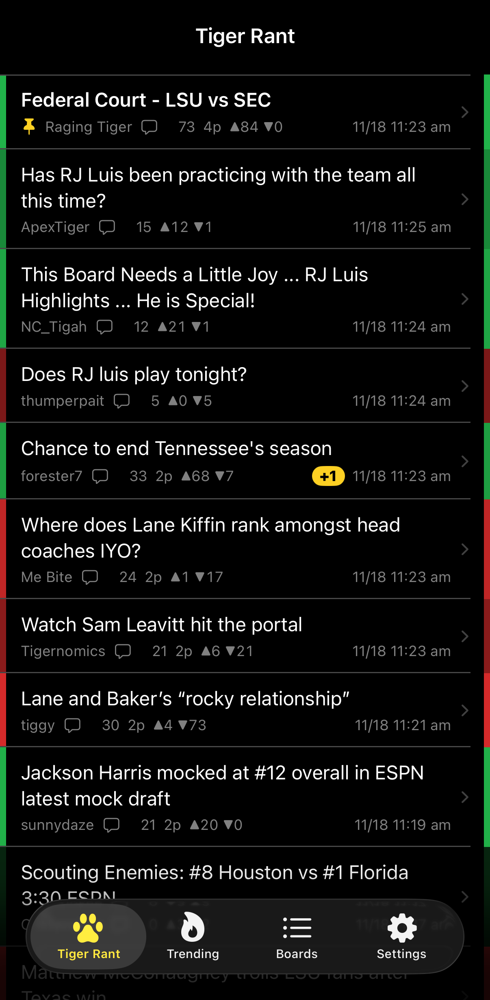
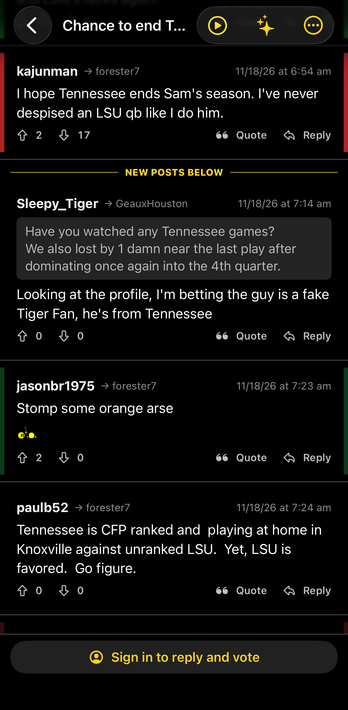
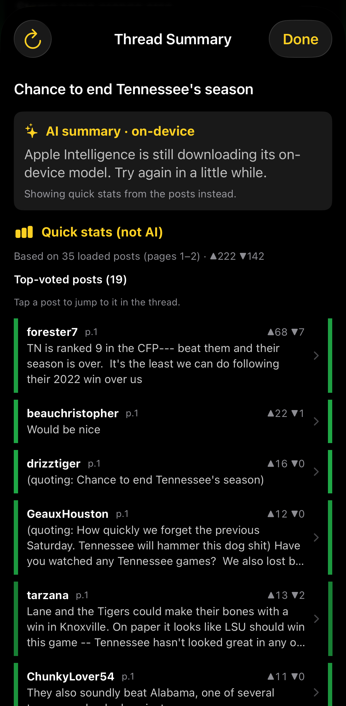
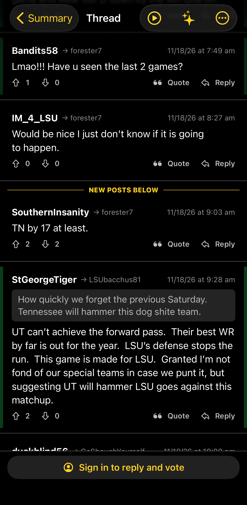
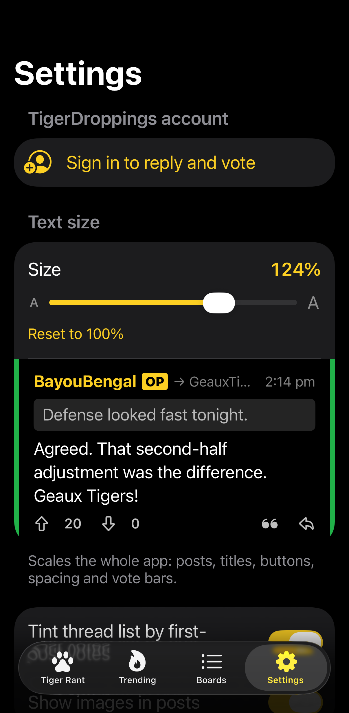
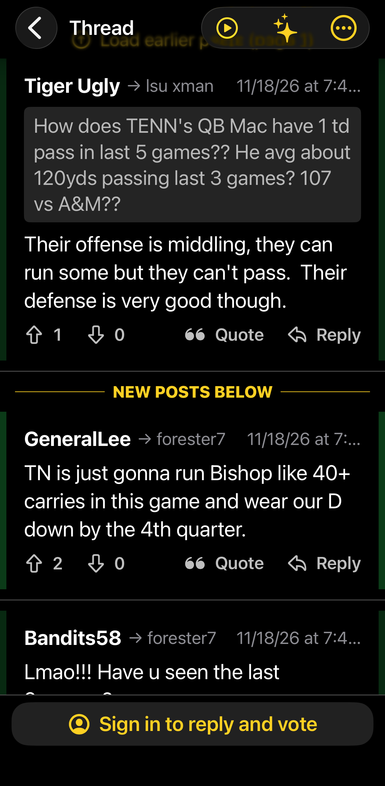

# Tiger Droppings iOS App (TD Live)

A fast, chat-style Tiger Droppings app for iPhone: an unofficial reader for the [TigerDroppings](https://www.tigerdroppings.com) LSU forums.

**Try it on TestFlight:** https://testflight.apple.com/join/w8mq3tyb

> Unofficial fan project. Not affiliated with, authorized, or endorsed by TigerDroppings.com. All forum content belongs to its authors and TigerDroppings.

## Features
- **Condensed, dark layout**: black background, white text, dividers between posts.
- **Vote heat bars**: green/red bars on each post and thread, stronger the more lopsided the votes (20-0 deep green, 10-5 faint green, 5-20 strong red).
- **Game day**: when Tiger Rant is locked, the app opens the LSU Score Board instead and shows the live score at the top of the board and the game thread. The Score Board is also in the Boards list.
- **Endless scrolling** through boards and threads.
- **Live mode**: polls every 5 seconds and drops new posts in place so a thread reads like a chat. In Live mode, posts are tighter (no per-post reply, quote, or vote buttons—the composer at the bottom is how you reply) so a fast thread is easier to follow, and the view stays pinned to the newest post unless you scroll up, in which case a “↓ N new” pill jumps you back.
- **Pick up where you left off**: a "+N" badge for new replies since your last visit, and threads reopen at your last-read post with a "NEW POSTS BELOW" marker.
- **Thread summary**: on-device AI summary with Apple Intelligence (iPhone 15 Pro or newer, iOS 26). No accounts or API keys. Other phones get quick stats (most active posters and every top-voted post). Tap a top-voted post to jump to it in the thread; the back button returns you to the summary.
- **Text size**: a slider in Settings (about 80% to 160%) that scales the whole app, including posts, titles, buttons, spacing and vote bars.
- **Optional sign-in** to reply, quote, and up/down vote, using the site's own login page. Your password is never stored; only session cookies, in the Keychain.

## Desktop (Chrome)

A [Tampermonkey userscript](https://raw.githubusercontent.com/Bayou-Brains/tigerdroppings-ios-app/main/web/tdlive.user.js) and an unpacked Chrome extension give the same condensed dark reader, vote bars, Live mode, and resume badges in your browser. The site's own login, reply, and voting keep working.

See [web/README.md](web/README.md) for install steps.

## Code
SwiftUI, iOS 17+. The project is generated from `project.yml` with [XcodeGen](https://github.com/yonaskolb/XcodeGen) (a generated `.xcodeproj` is included).

- `TigerDroppings/Scraper.swift`: fetches and parses the public site HTML (boards, thread lists, posts, votes).
- `VoteColor.swift`: score = ((up-down)/(up+down)) * (1 - e^(-(up+down)/8)); |score| < 0.08 is neutral.
- `ThreadListView.swift` / `ThreadView.swift`: endless lists, thread view, Live mode.
- `Auth.swift` / `Posting.swift`: sign-in via WKWebView, replies, votes.
- `Summarizer.swift`: Foundation Models summary with a non-AI fallback.
- `ReadStore.swift`: per-thread read positions.
- `TextSize.swift`: the app-wide text size setting.

Because it reads the site's HTML, layout changes on TigerDroppings can break parsing; fixes go in `Scraper.swift`.

To build it yourself, open the project in Xcode, set your own Development Team and bundle ID, and run.
