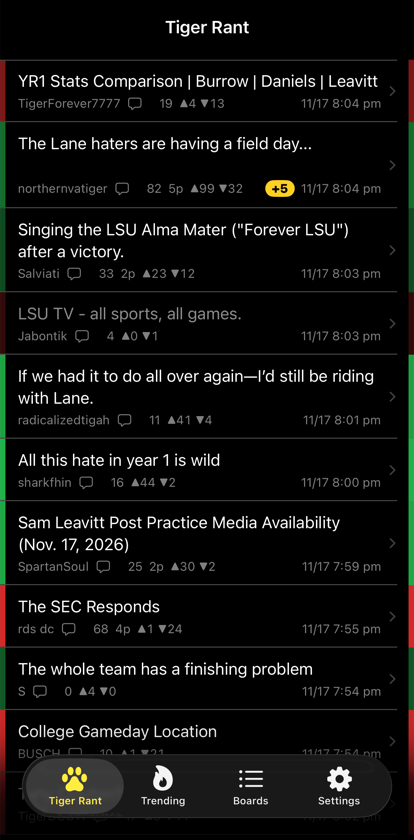
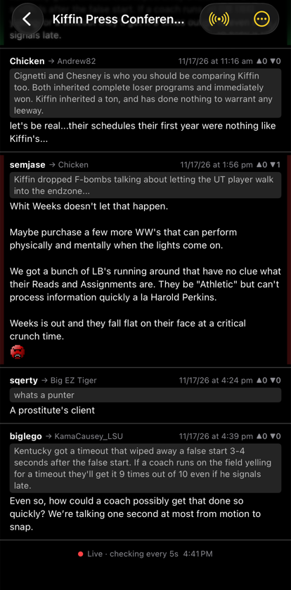
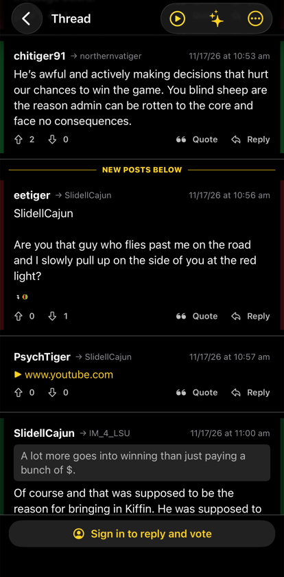

# Tiger Droppings iOS App (TD Live)

A fast, chat-style Tiger Droppings app for iPhone: an unofficial reader for the [TigerDroppings](https://www.tigerdroppings.com) LSU forums.

**Try it on TestFlight:** https://testflight.apple.com/join/w8mq3tyb

> Unofficial fan project. Not affiliated with, authorized, or endorsed by TigerDroppings.com. All forum content belongs to its authors and TigerDroppings.

## Features
- **Condensed, dark layout**: black background, white text, dividers between posts.
- **Vote heat bars**: green/red bars on each post and thread, stronger the more lopsided the votes (20-0 deep green, 10-5 faint green, 5-20 strong red).
- **Endless scrolling** through boards and threads.
- **Live mode**: polls every 5 seconds and drops new posts in place so a thread reads like a chat.
- **Pick up where you left off**: a "+N" badge for new replies since your last visit, and threads reopen at your last-read post with a "NEW POSTS BELOW" marker.
- **Thread summary**: on-device AI summary with Apple Intelligence (iPhone 15 Pro or newer, iOS 26). No accounts or API keys. Other phones get quick stats (top-voted posts, most active posters).
- **Optional sign-in** to reply, quote, and up/down vote, using the site's own login page. Your password is never stored; only session cookies, in the Keychain.

## Code
SwiftUI, iOS 17+. The project is generated from `project.yml` with [XcodeGen](https://github.com/yonaskolb/XcodeGen) (a generated `.xcodeproj` is included).

- `TigerDroppings/Scraper.swift`: fetches and parses the public site HTML (boards, thread lists, posts, votes).
- `VoteColor.swift`: score = ((up-down)/(up+down)) * (1 - e^(-(up+down)/8)); |score| < 0.08 is neutral.
- `ThreadListView.swift` / `ThreadView.swift`: endless lists, thread view, Live mode.
- `Auth.swift` / `Posting.swift`: sign-in via WKWebView, replies, votes.
- `Summarizer.swift`: Foundation Models summary with a non-AI fallback.
- `ReadStore.swift`: per-thread read positions.

Because it reads the site's HTML, layout changes on TigerDroppings can break parsing; fixes go in `Scraper.swift`.

To build it yourself, open the project in Xcode, set your own Development Team and bundle ID, and run.
